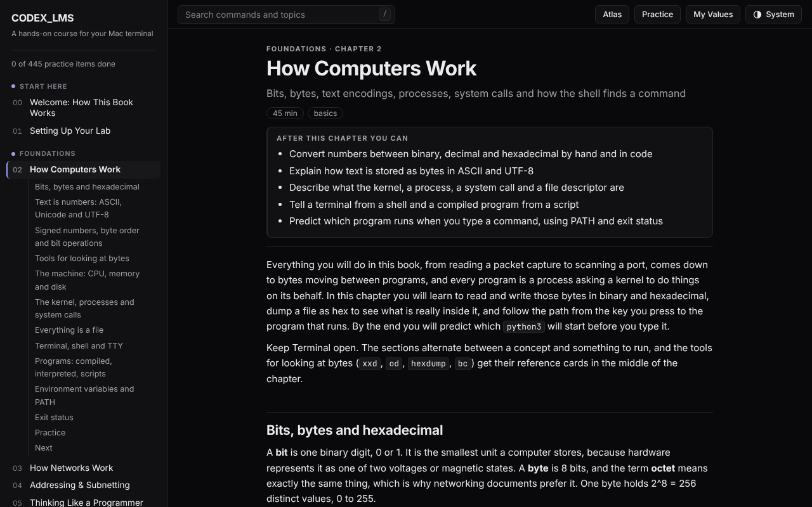
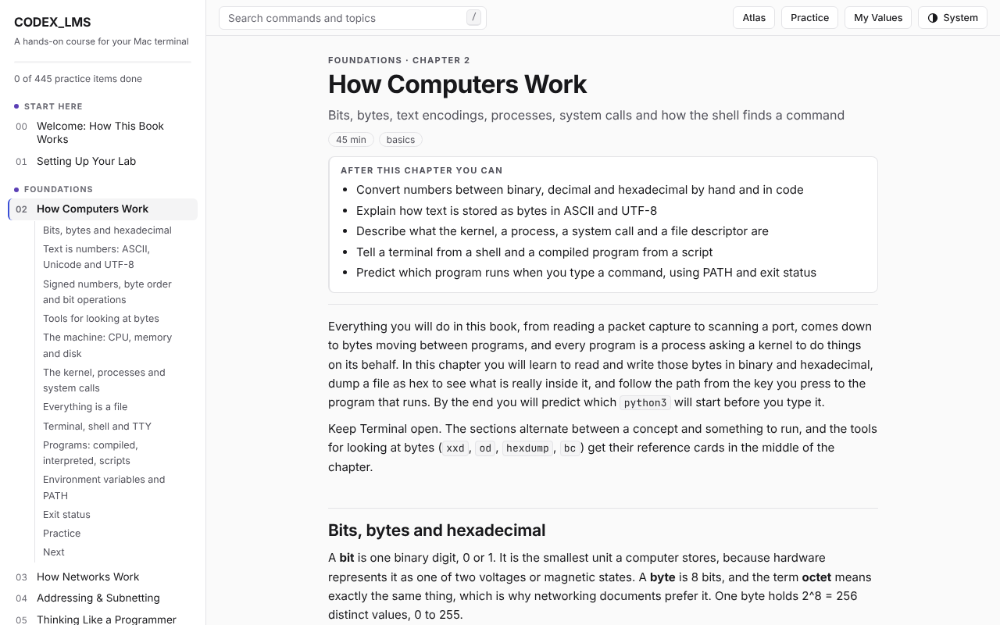
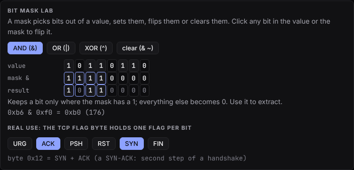
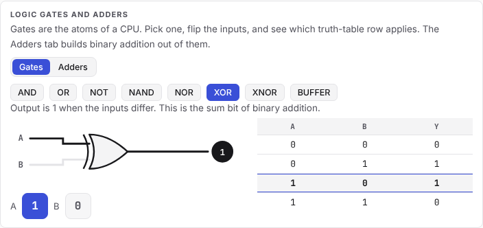

# CODEX_LMS

A hands-on, book-style course for learning on a Mac: macOS Terminal (zsh), networking, Python, web development
(HTML, CSS, JavaScript, DevTools, DOM, XML, Node.js), servers, APIs, encryption and cloud, and security
(Wireshark packet analysis, hardening, log triage and incident response). It is one
self-contained web page with runnable Python and JavaScript, a simulated terminal, interactive labs, exercises
with automatic checks, quizzes and projects.

- 50 chapters in 10 parts, 856 command cards, 270 exercises
- A Cisco IOS cheat sheet in the Reference part: modes, help keys, output filters, 69 IOS command cards with examples, and a DHCP & DNS lab infographic
- Python runs in the browser (Pyodide); JavaScript runs in a sandbox with a built-in practice REST API
- Light, dark and system themes; works on phones
- Nothing is downloaded when you open it: the fonts are bundled in the page, and `test/offline.py` fails CI if a request ever leaves it
- 19 interactive labs placed inside the sections they teach (bit switches, logic gates, packet dissector, cron explainer and more)

## Read it locally

    cd dist
    python3 -m http.server 8765

Then open http://localhost:8765/index.html. Opening `index.html` by double-clicking works for reading, but the
in-page Python needs to be served over HTTP.

## Look and feel

- **Theme:** the button in the top bar cycles **System, Light, Dark**. System follows your operating system live.
  The choice is saved with your progress.
- **Palette:** neutral greys, black and white with a single accent colour. Code keeps desaturated syntax colours so it stays readable.
- **Layout:** a compact 15px reading column with Inter and JetBrains Mono, both bundled in the page (`src/fonts/`), so there is no font server to contact.
- **Diagrams and command output** sit on a strict monospace grid. `tools/lint_ascii.py` and `test/ascii.py` fail the build if a box
  border drifts or if anything meant to line up falls back to a proportional font.

| Light | Dark |
|---|---|
|  |  |

## Interactive labs

Each lab sits next to the explanation it belongs to, not in a separate gallery. They are keyboard-operable, work on phones, and
respect reduced-motion settings.

| Lab | Where you find it | What it shows |
|---|---|---|
| Bit switches | How Computers Work, bits | flip bits; decimal, hex, two's complement, overflow |
| Text to bytes | How Computers Work, UTF-8 | code points and the 1 to 4 bytes UTF-8 uses |
| Bit mask lab | How Computers Work, bit operations; Python Basics, operators | AND, OR, XOR, clear; TCP flag byte; masking an IP address |
| Logic gates and adders | How Computers Work, the machine | gate symbols, truth tables, full adder, 4-bit ripple adder |
| Latency ladder | How Computers Work, the machine | cache, RAM, SSD, network scaled to human time |
| PATH lookup | How Computers Work, PATH; Python Modules, import | first match wins; shadowing (`python3`, a local `random.py`) |
| Search and sort racer | Thinking Like a Programmer | linear vs binary search; bubble, insertion and merge sort |
| Cron explainer | Shell Scripting, scheduling | plain-English meaning and the next five run times |
| Signals and process states | System, signals | STOP, CONT, TERM, KILL; zombies and `wait()` |
| ssh config builder | Remote Access with SSH | a `Host` block and the long command it replaces |
| HTML to DOM tree | HTML, the parser | what the browser builds from broken markup |
| Predict the result | JavaScript Fundamentals, operators | 14 coercion puzzles with explanations |
| Request waterfall | DevTools, Network | DNS, connect, TLS, TTFB, download; `curl -w` output |
| Semver ranges | Node.js, npm | which versions `^`, `~` and comparators allow |
| TTL and traceroute | Reachability, Latency and Path | why each hop answers |
| Take a packet apart | Packet Capture | hex dump of a TCP SYN and a DNS query, field by field |
| Avalanche effect | Encryption, hashes | one changed character flips about half the SHA-256 bits |
| How long to guess it? | Encryption, passwords | entropy vs fast and slow hashes |
| Decode, forge, verify a JWT | APIs | the payload is readable; editing it breaks the signature |

## Reference figures

Diagrams drawn on the same monospace grid, each placed in the section it illustrates (`tools/add_figures.py`; the APIs one is in
`chapters/ch_2_apis.py`):

| Figure | Where you find it |
|---|---|
| What runs on what: application protocols over TLS, QUIC, TCP, UDP and IP | How Networks Work, layers |
| One Ethernet frame on the wire, field by field, with the MTU marked | How Networks Work, encapsulation |
| Wi-Fi bands: 2.4 GHz channel overlap to scale; 5 and 6 GHz U-NII blocks | How Networks Work, Wi-Fi |
| A global IPv6 address split 48/16/64, and the IPv6 address family tree | Addressing, IPv6 |
| Reading `ls -l`, rwx to octal, and where setuid, setgid and sticky show | Files, permissions |
| The BPF capture-filter language on one screen | Packet Capture, BPF |
| The troubleshooting loop: gather, choose a layer, isolate, fix and verify, write down | Troubleshooting, method |
| Which observability tool sees which part of the machine (macOS, with Linux names) | System, looking at processes |
| The most used commands as a map | Cheat Sheets |
| REST, GraphQL, gRPC, WebSocket, SSE and webhooks as message sequences | APIs, kinds of web API |

<table><tr>
<td></td>
<td></td>
</tr></table>

## Apple app (macOS, iPadOS, iOS)

`apple/` holds a native SwiftUI app with the same book. It has a native sidebar with progress per chapter,
native search over chapters, sections and all command cards, back/forward, a section menu, an appearance
setting and text size (⌘+ / ⌘− / ⌘0 on the Mac, or the Appearance menu in the toolbar). The pages show in a web view, so in-page Python, JavaScript playgrounds, labs and the practice terminal
all work offline. Progress is saved by the app (Application Support), not by the browser.

**Ready-built Mac app:** every CI run uploads `CODEX_LMS-mac` (a zip with a universal `CODEX_LMS.app`). Open the
run under the repository's Actions tab, download it from Artifacts, unzip, and move the app to Applications. It is
not notarized, so the first time you open it macOS blocks it: open System Settings → Privacy & Security and click
**Open Anyway** (or run `xattr -dr com.apple.quarantine /Applications/CODEX_LMS.app`).

**Build it yourself** (also the way to run it on an iPhone or iPad). Needs Xcode 16 or later and [XcodeGen](https://github.com/yonaskolb/XcodeGen):

    python3 tools/chapters.py && python3 tools/build.py   # the app bundles dist/
    brew install xcodegen
    cd apple && xcodegen && open CODEX_LMS.xcodeproj

Pick the CODEX_LMS scheme and run on My Mac, an iPad or an iPhone. `swift test --package-path apple` runs the
tests for `CodexCore` (table of contents, saved progress, search) on macOS or Linux.

## Project layout

| Path | What it is |
|---|---|
| `data/book.json` | chapters 00-37 and 44-46 plus reference pages, as parsed JSON |
| `chapters/ch_*.py` | chapters 38-41 (Servers, APIs & Cloud) and 42-43 (Security), written with the helpers in `chapters/lib.py` |
| `data/outcache.json` | real outputs of every runnable block in chapters 38-43 |
| `src/engine.js` | page engine: rendering, navigation, search, progress, runners, earlier widgets |
| `src/ws-1..4-*.js`, `src/srv.add.css` | labs for chapters 38-41 |
| `src/ws-5-pcap.js`, `ws-6-pcapcols.js`, `ws-7-pktlab.js`, `ws-8-triage.js`, `src/sec.add.css` | the Wireshark packet lab and the log-triage drill for chapters 42-43; `ws-5-pcap.js` is the packet engine (encoder, dissector, display-filter engine) |
| `src/ws-labs.js`, `src/labs.add.css` | the 19 newer labs (**generated** from `packages/labs`) and their styles |
| `tools/pcapgen.js`, `tools/pcapcols.py` | write the lab captures as real `.pcap` files, and bake Wireshark's own column text into `src/ws-6-pcapcols.js` |
| `src/sim.js`, `src/sbsrc.js` | simulated zsh, and the sandbox injected into every JavaScript playground |
| `src/style.css`, `src/head.html` | design tokens, layout and page head |
| `src/fonts/` | Inter and JetBrains Mono (variable, Latin subset), inlined into the stylesheet by `tools/build.py`; SIL OFL 1.1 licences alongside |
| `packages/widgets/` | the logic behind the newer labs, as pure TypeScript with unit tests |
| `packages/labs/` | the DOM views for those labs; `npm run labs` bundles them into `src/ws-labs.js` |
| `tools/chapters.py`, `tools/build.py` | build chapter JSON, then assemble the single-file page |
| `tools/add_labs.py` | places each lab block inside its chapter in `data/book.json` (idempotent) |
| `tools/add_figures.py` | places the reference figures (ASCII diagrams with a lead-in) inside their chapters, the same way |
| `tools/lint_ascii.py`, `tools/fix_ascii.py` | find, and safely re-align, drifting box diagrams |
| `test/blocks.py`, `test/labs.py`, `test/ascii.py`, `test/theme.py` | browser tests: runnable blocks and exercises, every lab, diagram rendering, theme switch |
| `test/pcapfilters.py` | checks the Wireshark lab's display-filter engine against real `tshark` on the same captures |
| `dist/` | the built site: `index.html`, `toc.json` (contents for the Apple app) and the Python runtime in `py/` |
| `src/app.add.css` | hides the page's own sidebar and toolbar when it runs inside the Apple app |
| `apple/project.yml` | XcodeGen spec for the multiplatform app |
| `apple/Sources/CodexCore/` | Swift models for `toc.json` and saved progress, and search; tests in `apple/Tests/` |
| `apple/App/` | SwiftUI app: sidebar, search, web view, `codex://` scheme handler and the page bridge |

## Download and double-click

A release carries **`CODEX_LMS-all.zip`**: unzip it and double-click **Start CODEX_LMS.command**, which asks whether to open the Mac app, the web browser or the terminal version. The same release has the pieces on their own: `CODEX_LMS.html` (browser or `node CODEX_LMS.html`), `CODEX_LMS-mac.zip`, `codex-tui.mjs`, and `SHA256SUMS.txt`. The first launch of anything downloaded needs right-click > Open (it is not notarized).

## Terminal app

`node apps/tui/dist/codex-tui.mjs` (after `npm run tui:build`) or `npm run tui`. It reads the book from `dist/index.html`, shares your progress with the Mac app, supports mouse and keyboard, and has terminal versions of nineteen labs inside the sections that teach them (bit switches, logic gates, bit mask, text to bytes, cron, latency ladder, subnet, PATH lookup, semver, password cracking, avalanche, TTL trace, request waterfall, signals, JS coercion quiz, algorithm racer, ssh config, JWT, packet dissector). The remaining interactive widgets (the simulated practice terminal, playgrounds, diagram widgets) show a card pointing to the page or the Mac app. `?` shows the keys.

## One file: page, terminal app and Mac app

`python3 tools/bundle.py --app CODEX_LMS-mac.zip` (CI does this and uploads `CODEX_LMS-single-file`) writes **`CODEX_LMS.html`**, one file for whichever device you have:

| Where | How | What you get |
|---|---|---|
| Any browser | open the file | the book, offline, with Python exercises working even from `file://` |
| Terminal with Node 18+ | `node CODEX_LMS.html` | the terminal app (`--theme`, `--no-mouse`, `--list`, ...) |
| Mac | `node CODEX_LMS.html --app`, or "Other ways to open this" in the page | installs and opens the Mac app |

Also `--html` (serve the page and open a browser), `--extract DIR` and `--help`. The file is an HTML comment that is also a JavaScript comment (the Node launcher), so a browser ignores it and Node ignores the page. If Node reports `ERR_UNKNOWN_FILE_EXTENSION` (the folder's `package.json` says `"type": "module"`), run `node -e "require('./CODEX_LMS.html')" -- --tui`. About 10 MB without the Mac app; `--no-python` makes it smaller.

## Build and test

Needs Python 3 and Playwright, pinned to the version CI uses (`python3 -m pip install playwright==1.63.0 && python3 -m playwright install chromium`),
and Node 20.19+ for the labs.

    python3 tools/chapters.py      # chapters/*.py -> data/new/*.json
    python3 tools/build.py         # -> dist/index.html, dist/toc.json (and pub.html for the Claude artifact host)
    (cd dist && python3 -m http.server 8765 &)
    python3 test/blocks.py servers apis crypto cloud wireshark defend
    python3 test/labs.py           # every lab: placement, interaction, no console errors
    python3 test/ascii.py          # diagrams and command output on a monospace grid (--hinting mimics a Linux CI renderer)
    python3 test/theme.py          # System / Light / Dark button, persistence, live OS changes
    python3 test/offline.py        # the page makes no request outside itself; the bundled fonts load
    python3 test/bundle.py FILE    # the single file: as a page, with Python, and under node
    python3 tools/lint_ascii.py    # box borders that do not line up
    python3 test/pcapfilters.py    # needs node and tshark (apt install tshark, or brew install wireshark)

    npm install
    npm test                       # logic behind the labs
    npm run labs                   # rebuild src/ws-labs.js after editing packages/labs or packages/widgets

Add `--update` to `test/blocks.py` after changing code in a chapter to record its new real output. After changing a
capture scenario in `src/ws-5-pcap.js`, run `python3 tools/pcapcols.py` (needs `tshark`) to refresh the column text,
then `test/pcapfilters.py`.
`test/blocks.py` on the full book reports 21 known mismatches in blocks that deliberately raise errors; they are identical on
the version before the redesign and are not part of the CI set.

### Adding a lab

1. Put the logic in `packages/widgets/src/<name>.ts` with tests in `packages/widgets/test/`.
2. Write the view in `packages/labs/src/<name>.ts` (`register("name", ...)`) and import it from `packages/labs/src/index.ts`.
3. Add an entry to `LABS` in `tools/add_labs.py` naming the chapter and the text it should follow, then run it.
4. `npm run labs`, `python3 tools/build.py`, and add a case to `test/labs.py`.

## Parked prototypes

An earlier round built a React + Tauri desktop app and an Ink terminal app on the same widget logic. They were removed from the
tree when the focus moved to the classic site and remain in the repository history (commit `bf04bb1`). `packages/widgets` is kept,
including the terminal-only renderers (`ascii.ts`, `subnet.ts`), so a terminal or desktop version can reuse the same logic.

## License

MIT, see `LICENSE`. The bundled Pyodide runtime in `dist/py/` keeps its own license (MPL-2.0), and the bundled fonts in
`src/fonts/` keep theirs (SIL Open Font License 1.1, copies next to the files).
