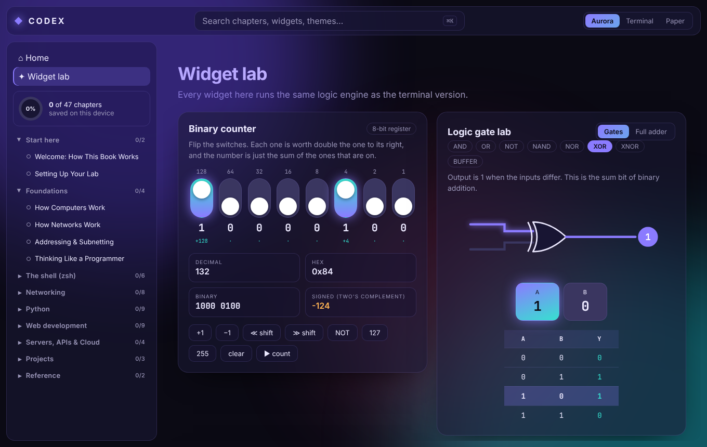

# CODEX_LMS

A hands-on, book-style course for learning on a Mac: macOS Terminal (zsh), networking, Python, web development
(HTML, CSS, JavaScript, DevTools, DOM, XML, Node.js) and servers, APIs, encryption and cloud. It is one
self-contained web page with runnable Python and JavaScript, a simulated terminal, interactive labs, exercises
with automatic checks, quizzes and projects.

- 47 chapters in 9 parts, 776 command cards
- Python runs in the browser (Pyodide); JavaScript runs in a sandbox with a built-in practice REST API
- Dark and light themes, works on phones

## Three ways to use it

One course, one shared logic engine, three front-ends:

| | What | Run it |
|---|---|---|
| **Classic site** | the original single self-contained page in `dist/`, with runnable Python and JavaScript and the simulated terminal | `cd dist && python3 -m http.server 8765` |
| **Desktop / web app** (`apps/gui`) | React + Framer Motion, glass UI, command palette (Ctrl/Cmd+K), three themes, animated interactive widgets; wrapped as a native app by Tauri | `npm install && npm run gui` |
| **Terminal app** (`apps/tui`) | Ink: animated ASCII, colour themes, full mouse support (click and scroll), the same widgets drawn as ASCII | `npm install && npm run tui` |

The interactive widgets (binary counter, logic gates and full adder, subnet calculator) are pure state machines in
`packages/widgets`, so the GUI draws them as animated components and the TUI draws them as ASCII frames from the same logic.
Chapters are exported from the book data to `content/` (`npm run outline`) and lazy-loaded one at a time.
The classic page's exercises and labs are not ported yet: they show as stubs in the new apps.

## Read it locally (classic site)

    cd dist
    python3 -m http.server 8765

Then open http://localhost:8765/index.html. Opening `index.html` by double-clicking works for reading, but the
in-page Python needs to be served over HTTP.

## Project layout

| Path | What it is |
|---|---|
| `data/book.json` | chapters 00-37 and 42-44 plus reference pages, as parsed JSON |
| `chapters/ch_*.py` | chapters 38-41 (Servers, APIs & Cloud), written with the helpers in `chapters/lib.py` |
| `data/outcache.json` | real outputs of every runnable block in chapters 38-41 |
| `src/engine.js` | page engine: rendering, navigation, search, progress, runners, earlier widgets |
| `src/ws-*.js`, `src/srv.add.css` | labs for chapters 38-41 |
| `src/sim.js`, `src/sbsrc.js` | simulated zsh, and the sandbox injected into every JavaScript playground |
| `src/style.css`, `src/head.html` | styles and page head |
| `tools/chapters.py`, `tools/build.py` | build chapter JSON, then assemble the single-file page |
| `test/blocks.py` | runs every code block and exercise of the given chapters inside the real page |
| `dist/` | the built classic site: `index.html` plus the Python runtime in `py/` |
| `packages/widgets/` | shared widget engine (TypeScript): bits, logic gates, adders, subnet maths, ASCII renderers, with tests |
| `apps/gui/` | React + Vite app, with the Tauri desktop shell in `src-tauri/` |
| `apps/tui/` | Ink terminal app (`npm run tui`) |
| `content/` | per-chapter JSON for the new apps, generated by `tools/export_outline.py` |
| `docs/screenshots/` | screenshots used in this README |

## Build and test

Needs Python 3 and Playwright, pinned to the version CI uses (`python3 -m pip install playwright==1.63.0 && python3 -m playwright install chromium`).

    python3 tools/chapters.py      # chapters/*.py -> data/new/*.json
    python3 tools/build.py         # -> dist/index.html (and pub.html for the Claude artifact host)
    (cd dist && python3 -m http.server 8765 &)
    python3 test/blocks.py servers apis crypto cloud

For the new apps (Node 20.19+):

    npm install
    npm test                       # widget engine unit tests
    npm run gui:build              # type-check + production build of the GUI
    (cd apps/tui && npx tsc --noEmit)

Add `--update` to `test/blocks.py` after changing code in a chapter to record its new real output.

## License

MIT, see `LICENSE`. The bundled Pyodide runtime in `dist/py/` keeps its own license (MPL-2.0).
